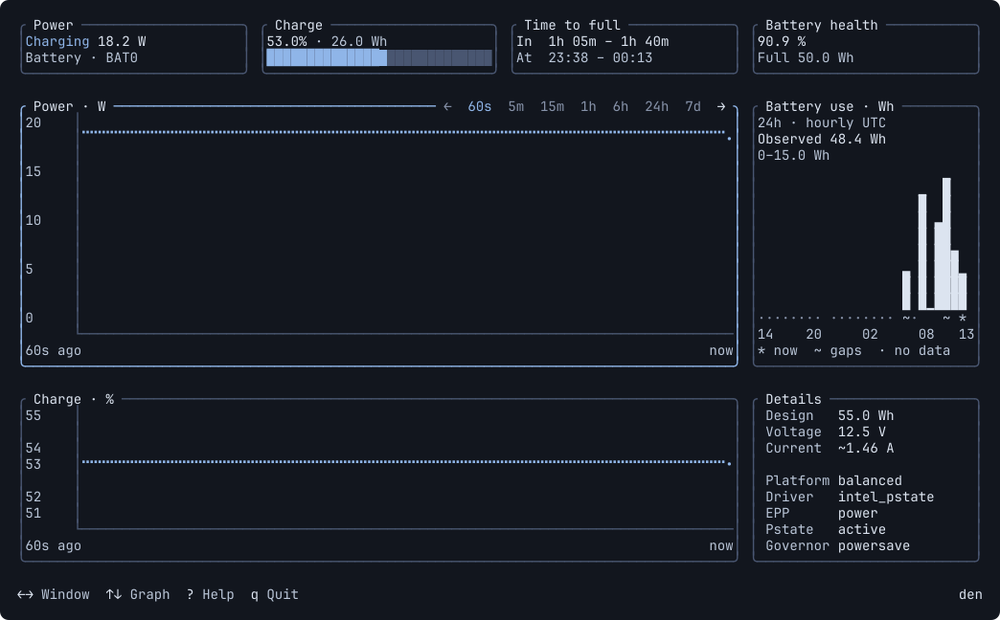

# den

A lightweight Linux battery history recorder and live terminal monitor.



- Live power and charge graphs, updated every second.
- Optional background recording to SQLite, normally every 30 seconds.
- Hourly recorded battery use, battery health, and read-only power-setting details.
- Experimental time-to-empty / time-to-full ranges, with duration and clock times.

The viewer works without a daemon and never writes history. Den does not change
power settings or charging thresholds. An 80×24 or larger terminal is recommended.
The screenshot uses synthetic data.

## Install

With Nix (`x86_64-linux` and `aarch64-linux`):

```sh
nix run github:yawarakatai/den
# Or install permanently:
nix profile install github:yawarakatai/den
```

Alternatively, with a recent stable Rust toolchain and a C compiler:

```sh
cargo install --git https://github.com/yawarakatai/den --locked
```

## Use

```sh
den                         # Live monitoring; no recorder required
den daemon                  # Record history in a separate terminal
den tui --history-only      # Inspect saved history without live sensors
```

The recorder defaults to `$XDG_STATE_HOME/den/history.sqlite3`, or
`~/.local/state/den/history.sqlite3`. The viewer prefers the NixOS service's
history when present. Pass `--database PATH` to either command to choose a file.
Installing the package or opening the viewer does not start a recorder.

| Key       | Action                      |
| --------- | --------------------------- |
| `←` / `→` | Change time window          |
| `↑` / `↓` | Select Power / Charge       |
| `?`       | Help and available controls |
| `q`       | Quit                        |

## NixOS service

Add the flake input, then import its module. The module below expects `inputs`
to be passed through NixOS `specialArgs`:

```nix
inputs.den.url = "github:yawarakatai/den";
```

```nix
{ inputs, ... }:
{
  imports = [ inputs.den.nixosModules.default ];
  services.den = {
    enable = true;
    readers = [ "alice" ]; # Replace with your login name
    # sampleInterval = 30;
    # retentionDays = 90;
  };
}
```

The service runs as the dedicated non-root `den` user and records to
`/var/lib/den/history.sqlite3`. Readers need a new login session after joining
the group. History can reveal when a machine is used; reader access is opt-in.

## Before relying on the data

- Watts measure **battery flow**, not total PC consumption or AC input.
- Missing readings are not zero. Hourly use covers only observed saved intervals.
- ETA ranges are **uncalibrated heuristics**, not probability guarantees. Charging
  taper and configured charge limits are not modeled. `Not charging` can be a
  normal charge-limit stop; it does not imply a user pause or reported `Full`.
- CPU/GPU/whole-system power collection is not implemented. Actual service
  sandboxing, group access, suspend behavior and resource use still need real
  deployment validation; the current Nix module check evaluates wiring only.

[User guide](docs/guide.md) · [Development](docs/development.md) ·
[Design and limitations](docs/design.md)

## License

[MIT](LICENSE)
